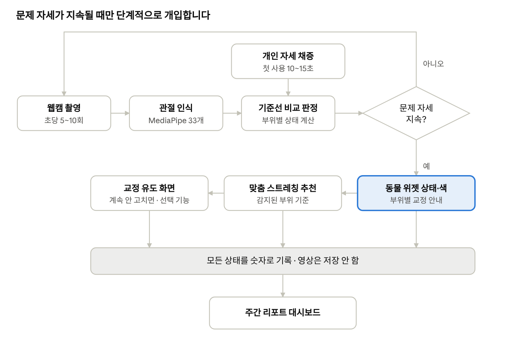

# 바른생활 기획서

AI 컴퓨터 자세교정 & 스트레칭 코치

2026-10-06 · [온라인 문서](https://claude.ai/code/artifact/36afa55e-7fda-4159-9980-ae1a89f8c016)

## 1. 서비스 개요

**바른생활**은 컴퓨터 앞에 앉은 사용자의 자세를 AI가 계속 지켜보고, 잘못된 자세가 이어지면 바로 교정 방법까지 알려주는 개인 맞춤형 자세 코치입니다.

**배경과 문제**

- 하루 대부분을 컴퓨터 앞에서 보내면서 거북목, 어깨 불균형, 몸 기울어짐이 습관이 됩니다.
- 자세가 무너지는 순간은 본인이 알아차리기 어렵고, 알아차려도 곧 원래대로 돌아갑니다.
- 기존 알림형 서비스는 일정 시간마다 울려서 작업을 방해하고, 무엇을 어떻게 고쳐야 하는지 알려주지 않습니다.

**핵심 목표**

- 작업을 방해하지 않으면서 지금 자세를 한눈에 알게 한다.
- 단순 경고가 아니라 어느 부위를 어떻게 고칠지 구체적으로 안내한다.
- 사람마다 다른 평소 자세를 기준으로 판정해 정확도를 높인다.
- 카메라 사용 여부와 정확도 수준을 사용자가 직접 고르게 한다.

## 2. 사용 모드 3단계

사용자가 프라이버시, 편의성, 정확도 중 무엇을 우선할지 고를 수 있도록 세 가지 모드를 제공합니다.

| 모드 | 카메라 | 설치 | 감지 방식 | 대상 |
| --- | --- | --- | --- | --- |
| **기본 모드** | 끔 | 없음 | 질문으로 셀프 체크 유도 | 카메라가 부담스럽거나 없는 사용자 |
| **웹캠 모드** | 노트북 내장 또는 모니터 위 웹캠(정면) | 없음 | 실시간 AI 분석 | 대부분의 사용자 |
| **정밀 모드** | 측면 45°에 휴대폰 또는 USB 웹캠 거치 | 거치대 | 실시간 AI 분석, 정면과 함께 쓰면 전체 자세 | 정확도를 원하는 사용자 |

**기본 모드 셀프 체크 방식**

- 키보드·마우스를 오래 연속으로 쓸 때만 질문합니다. 시간마다 묻지 않습니다.
- 글 대신 자세 그림 3~4개 중 "지금 내 자세와 비슷한 것"을 한 번 클릭으로 고릅니다.
- 답변이 쌓이면 "오후 3시 이후 거북목이 많아요" 같은 리포트로 보여줍니다.

**모드별 감지 가능 항목** (◎ 잘 됨 · ○ 대체로 됨 · △ 간접 추정 · ✕ 불가)

| 항목 | 웹캠(정면) | 정밀(측면) |
| --- | --- | --- |
| 고개 좌우 기울임 | ◎ | ✕ |
| 어깨 불균형 | ◎ | ✕ |
| 어깨 으쓱(긴장) | ◎ | ○ |
| 턱 괴기 | ◎ | ○ |
| 장시간 앉기·자리 비움 | ◎ | ◎ |
| 화면에 가까워짐 | ○ | ○ |
| 고개 숙임 | ○ | ◎ |
| 상체 좌우 기울어짐 | ○ | ✕ |
| 거북목 | △ | ◎ (CVA 각도 직접 측정) |
| 구부정·등 굽음 | △ | ◎ |
| 허리 앞뒤 굽음 | ✕ | ○ |
| 다리 꼬기 | ✕ | △ (하체가 보이게 놓을 때) |

정면과 측면은 서로 약점을 보완합니다. 두 카메라를 함께 쓸 때만 "전체 자세 체크"라고 표현합니다.

## 3. 주요 기능

평소에는 동물 위젯의 동작과 색으로만 조용히 알리고, 문제가 오래 이어질 때만 구체적인 안내와 스트레칭을 제시합니다.

**실시간 AI 자세 분석**

- 웹캠 영상에서 관절 위치를 찾고, 어깨 기울기·고개 각도·얼굴 크기 비율 등을 계산합니다.
- 초당 5~10회만 분석해 CPU와 배터리 부담을 줄입니다.
- 잠깐 나타났다 사라지는 자세는 무시하고, 일정 시간 이상 이어질 때만 문제로 봅니다.

**부위별 교정 안내**

- "목이 앞으로 나와 있어요", "오른쪽 어깨가 내려가 있어요", "턱을 괴고 있어요"처럼 부위와 방향을 구체적으로 알려줍니다.

**AI 동물 위젯** (핵심 차별점)

맥의 RunCat처럼 귀여운 동물이 화면에 항상 떠 있고, **내 자세를 그대로 따라 하며 상태와 색이 바뀝니다.** 팝업 없이 동물의 변화만으로 자신의 자세를 알아차립니다.

| 내 자세 | 동물 상태 | 색 |
| --- | --- | --- |
| 바른 자세 | 꼿꼿이 서서 신나게 움직임 | 원래 색 |
| 거북목 | 목이 앞으로 쭉 빠짐 | 노랑 → 빨강 |
| 고개·몸 기울어짐 | 같은 방향으로 기울어짐 | 노랑 → 빨강 |
| 어깨 으쓱 | 어깨가 귀까지 올라감 | 노랑 |
| 구부정 | 축 처지고 등이 굽음 | 노랑 → 빨강 |
| 턱 괴기 | 앞발로 턱을 굄 | 노랑 |
| 오래 앉아 있음 | 졸거나 하품하며 "쉬자" 말풍선 | 회색 |
| 자리 비움·일시정지 | 잠듦 | 흐림 |
| 자세를 고침 | 반짝이며 기뻐함 | 잠깐 초록 |

- **칭찬 반응**: 자세를 고치면 동물이 기뻐합니다. 혼나기만 하면 꺼버리므로, 고치고 싶게 만드는 장치입니다.
- **동물 고르기**: 미어캣(대표 캐릭터, 꼿꼿이 서는 바른 자세의 상징), 거북이(거북목이면 목이 쭉), 고양이, 펭귄, 강아지 등. 처음엔 2~3종으로 시작합니다.
- **동물 해금**: "바른 자세 ○시간 달성" 같은 목표를 채우면 새 동물을 얻어, 꾸준히 쓰게 만듭니다.
- **색약 배려**: 색만으로 구분하지 않고 동작과 표정도 함께 바꿉니다.

**표시 방식** (둘 다 제공)

| | 데스크톱 위젯 | 메뉴바 모드 (RunCat 방식) |
| --- | --- | --- |
| 위치 | 화면 어디든 드래그해서 놓기 | 맥 상단 메뉴바 |
| 표현 | 자세 따라 하기 + 색 | 자세가 좋으면 신나게 뛰고, 나쁘면 느려지다 주저앉음 |
| 장점 | 귀엽고 눈에 잘 띔 | 화면을 전혀 가리지 않음 |

**위젯 동작**

- 드래그로 위치를 옮기고, 다음 실행 때도 그 자리를 기억합니다.
- 항상 위에 표시되고, 모든 데스크톱 화면(Spaces)에서 보입니다.
- 크기는 작게·보통·크게 중에 고릅니다.
- 클릭 통과 옵션을 켜면 위젯 뒤의 창을 클릭할 수 있습니다.
- 동물을 클릭하면 오늘 자세 점수, 스트레칭 추천, 일시정지(30분 끄기) 메뉴가 나옵니다.
- 전체 화면 앱이나 화상회의 중에는 자동으로 숨습니다.

**맞춤형 스트레칭 추천**

- 감지된 문제에 맞는 스트레칭을 추천합니다. 예: 거북목 → 턱 당기기, 목 뒤 스트레칭.
- 카메라 모드에서는 스트레칭을 실제로 따라 했는지 자세 인식으로 확인합니다.

**사용 편의 자동 처리**

- 자리를 비우면 분석을 멈추고, 돌아오면 다시 시작합니다.
- Zoom·Teams 등 화상회의가 카메라를 쓰면 자동으로 일시정지합니다.
- 카메라나 노트북 화면 각도가 바뀐 것 같으면 다시 채증할지 묻습니다.
- 업무 시간에만 켜지도록 예약할 수 있습니다.

## 4. 교정 유도 화면 (노트북 사용 제한)

자세를 고치지 않으면 화면을 가려 바르게 앉도록 유도합니다. 한번 잘못 막으면 사용자가 바로 앱을 지우므로, **정확도와 오작동 방지가 가장 중요한 기능**입니다.

**단계적 발동**

1. 동물 위젯이 내 자세를 따라 하며 노랑 → 빨강으로 변함
2. 작은 알림으로 부위별 안내
3. 화면이 점점 흐려짐
4. 그래도 고치지 않으면 화면 전체를 덮는 교정 유도 화면 표시

대부분은 3단계(흐려짐)에서 자세를 고치도록 설계합니다. 운영체제를 실제로 잠그는 것이 아니라, 앱이 화면 위에 창을 덮는 방식입니다.

**해제 조건**

- 카메라 모드: 바른 자세로 3초 유지한 것을 카메라로 확인한 뒤, "바른 자세로 앉자"를 타이핑
- 기본 모드(카메라 끔): 타이핑만으로 해제
- 타이핑만으로 풀리면 구부정한 채로 쳐버릴 수 있어서, 카메라 모드에서는 자세 확인이 먼저입니다.

**오작동 방지**

- 기본값은 꺼두고, 사용자가 "집중 교정 모드"로 직접 켭니다.
- 판정 확신도가 높고 오래 지속될 때만 발동합니다. 경고 기준보다 훨씬 보수적으로 잡습니다.
- 하루 2~3회는 바로 넘길 수 있는 비상 해제를 둡니다.
- 화상회의·발표 중에는 발동하지 않습니다.
- "지금 바른 자세인데요" 신고 버튼으로 잘못된 판정을 바로잡습니다.

## 5. AI 개인화

모든 사람에게 같은 기준을 적용하지 않고, **그 사람의 평소 바른 자세보다 얼마나 달라졌는지**로 판정합니다. 체형과 카메라 위치가 달라도 정확하게 판정할 수 있고, 정면 카메라로 거북목을 추정할 수 있는 근거가 됩니다.

**첫 사용 시 개인 자세 채증 (10~15초)**

1. 카메라 화면에 사람 모양 점선 윤곽을 띄우고 "이 안에 맞춰 앉아주세요"라고 안내합니다.
2. 앱이 확인하고 알려줍니다: "조금 더 뒤로 앉아주세요", "어깨가 안 보여요", "너무 어두워요".
3. 바른 자세로 10~15초 앉아 있는 동안 각도·비율 값을 측정하여 개인 기준선으로 저장합니다.
4. 채증 중 움직임이 크면 "다시 해주세요"라고 안내합니다.

**기준선 관리**

- 정면과 측면은 기준선이 다르므로 **모드별로 따로 채증**합니다.
- 카메라·화면 각도가 바뀌거나 판정이 계속 틀릴 때 다시 채증을 권합니다.
- "지금 바른 자세인데요" 신고가 들어오면 기준선을 조금씩 보정합니다.
- 사용 기록이 쌓일수록 개인의 평소 패턴(평균·편차)을 갱신해 판정이 정확해집니다.

**거북목 추정 원리 (정면 카메라)**

- 거북목: 얼굴만 커지고 어깨 너비는 그대로 (머리만 앞으로 나옴)
- 몸 전체를 숙임: 얼굴과 어깨가 함께 커짐
- 이 비율 차이를 개인 기준선과 비교해 둘을 구분합니다.

## 6. 주간 리포트 대시보드

일·주 단위로 자세 변화를 보여주고, 매주 한 줄 코멘트로 개선 정도를 알려줍니다.

| 항목 | 내용 | 표현 방식 |
| --- | --- | --- |
| 바른 자세 유지 비율 | 전체 사용 시간 중 바른 자세 비율, 지난주 대비 | 큰 숫자 + 변화량 |
| 부위별 문제 시간 | 거북목 ○시간, 어깨 기울어짐 ○분 등 | 가로 막대 |
| 요일·시간대별 패턴 | "수요일 오후에 자세가 무너져요" | 히트맵 |
| 자주 발생한 자세 | 이번 주 가장 많이 나온 문제 자세 순위 | 순위 목록 |
| 교정 유도 화면 발동 | 발동 횟수, 해제까지 걸린 시간 | 숫자 |
| 스트레칭 수행 | 추천 대비 실제 수행 횟수 | 숫자 |
| 한 줄 코멘트 | "이번 주는 거북목이 20% 줄었어요" | 문장 |

기본 모드(카메라 끔) 사용자는 셀프 체크 답변을 바탕으로 같은 리포트를 받습니다.

## 7. 서비스 흐름

바른 자세면 캐릭터가 초록색으로 유지되고 분석만 계속됩니다. 기본 모드(카메라 끔)는 촬영·인식 대신 셀프 체크 질문으로 상태를 입력받고, 나머지 흐름은 같습니다.

## 8. 기술 구성과 AI 학습 계획

관절 인식은 사전학습된 Google MediaPipe Pose를 그대로 쓰고, **자세 판정 모델만 직접 구축한 데이터로 학습**합니다. 모든 분석은 사용자 PC 안에서 이뤄지며 서버가 필요 없습니다.

**기술 스택**

| 역할 | 기술 |
| --- | --- |
| 관절 인식 | Google MediaPipe Pose Landmarker (관절 33개) |
| 떨림 보정 | One Euro Filter |
| 데스크톱 위젯·교정 유도 화면 | Electron (투명하고 항상 위에 떠 있는 창) |
| 캐릭터 | Rive 애니메이션(또는 상태별 이미지), 메뉴바는 Electron Tray |
| 데이터 저장 | SQLite (각도와 상태만 저장) |
| 대시보드 그래프 | Chart.js |
| 학습·분석 | Python, pandas, scikit-learn |
| 모델 실행 | ONNX 변환 후 onnxruntime-web |

**AI 구조: 3층**

| 층 | 하는 일 | 방법 |
| --- | --- | --- |
| ① 인식 | 영상에서 관절 좌표 추출 | MediaPipe (사전학습 모델, 그대로 사용) |
| ② 판정 | 정상·거북목·기울어짐 등 구분 | 1차 규칙 기반 → 2차 Random Forest (직접 학습) |
| ③ 개인화 | 사람마다 다른 평소 자세 반영 | 개인 기준선 대비 차이값 |

**관절 인식: Google MediaPipe Pose**

- 추가 학습 없이 노트북 CPU에서 실시간으로 돌아갑니다.
- 관절 33개에 귀·입·손목이 포함돼 거북목 추정과 턱 괴기 판정에 유리합니다.
- JS·Electron에서 웹캠 연결부터 실행까지 바로 쓸 수 있습니다. 라이선스는 Apache-2.0입니다.
- 공개 데이터 MultiPosture가 MediaPipe 좌표 형식이라 판정 모델 학습에 바로 쓸 수 있습니다.
- 어두운 조명과 상체만 크게 나오는 노트북 웹캠 화면에서 잘 잡히는지는 데이터 확인 단계에서 점검합니다.

**학습 절차**

1. **데이터 수집**: 팀원·지인 10명 이상이 정면 웹캠 앞에서 자세별로 30초씩 촬영합니다. 영상은 저장하지 않고 관절 좌표만 CSV로 저장합니다.
2. **라벨**: 바른 자세, 거북목, 고개 숙임, 고개 기울임(좌·우), 어깨 기울어짐(좌·우), 어깨 으쓱, 몸 기울어짐(좌·우), 턱 괴기
3. **전처리**: 어깨 중심을 원점으로, 어깨 너비를 1로 맞춰 위치와 거리 차이를 없앱니다.
4. **특징 추출**: 어깨 기울기, 고개 기울기, 얼굴 크기 비율, 귀–어깨 거리 등 9개를 계산하고, 본인 바른 자세 값을 빼서 차이값으로 넣습니다.
5. **학습**: 부위별(목·어깨·상체) Random Forest 모델을 학습합니다. 비교용으로 XGBoost도 시험합니다.
6. **검증**: 사람 단위로 나눠 **처음 보는 사람**으로 테스트합니다. 혼동 행렬과 자세별 재현율을 봅니다.
7. **비교**: 규칙 기반과 학습 모델의 정확도를 비교해 AI 적용 효과를 제시합니다.

**참고 공개 데이터**

- [MultiPosture](https://zenodo.org/records/14230872): 13명, MediaPipe 관절 좌표 CSV, 상체 5종·하체 7종 라벨 (CC BY 4.0). 판정 모델 학습에 바로 사용
- [posture\_correction\_v4](https://universe.roboflow.com/posturecorrection/posture_correction_v4): 4,666장, 고개·어깨·구부정 라벨 (CC BY 4.0). 부위별 판정 학습용
- [Sitting Posture Detection (frontposture)](https://universe.roboflow.com/frontposture/sitting-posture-detection-3933f-jkzts): 490장, 숙임·기대기·구부정 라벨. 정면 판정 학습·테스트용
- [Roboflow Sitting Posture](https://universe.roboflow.com/dataset-sqm0h/sitting-posture-ezkda): 938장, 바른/나쁜 자세 (CC BY 4.0). 전체 판정 테스트용
- [Kaggle Posture Keypoints Detection](https://www.kaggle.com/datasets/melsmm/posture-keypoints-detection): 앉은 자세 관절 라벨, 관절 인식 정확도 점검용
- [Zenodo Forward Head Posture](https://zenodo.org/records/17550555): 92명의 CVA 측정값, 거북목 기준 각도의 근거

정면 웹캠 + 책상 앉은 자세에 맞는 대규모 공개 데이터는 없어서, 실제 판정은 직접 구축한 데이터로 맞춥니다.

## 9. 프라이버시와 한계 대응

**영상은 저장하거나 전송하지 않고, 기기 안에서 분석한 뒤 숫자(각도·상태)만 기록합니다.**

**프라이버시**

- 첫 화면에 "영상은 저장·전송되지 않습니다"를 명확히 표시합니다.
- 위젯에 분석 중 표시와 끄기 버튼을 항상 보여줍니다.
- 설정에서 카메라 미리보기로 앱이 무엇을 보는지 확인할 수 있습니다.
- 카메라가 부담스러운 사용자는 기본 모드(카메라 끔)를 쓸 수 있습니다.

**한계와 대응**

| 한계 | 대응 |
| --- | --- |
| 정면 카메라로는 거북목 각도를 직접 잴 수 없음 | 개인 기준선 대비 얼굴·어깨 비율로 추정, 정밀 모드 제공 |
| 노트북 웹캠에는 하체가 안 보임 (다리 꼬기) | 정밀 모드의 확장 기능으로 분리 |
| 역광·어두운 조명에서 인식률 저하 | 채증 단계에서 조명 안내 |
| 화면·카메라 각도가 바뀌면 기준선이 틀어짐 | 변화를 감지해 재채증 제안 |
| 잘못된 판정으로 교정 유도 화면이 뜨면 불만 | 보수적 기준, 비상 해제, 틀림 신고 버튼 |
| 상시 분석에 따른 배터리 소모 | 초당 5~10회만 분석, 배터리 모드에서 더 줄임 |
| Windows에서 카메라를 다른 앱과 동시에 못 씀 | 화상회의 감지 시 자동 일시정지 |

## 10. 팀 역할, 일정, 기대 효과

4명 기준으로 AI 쪽 2명, 앱 쪽 2명으로 나눕니다. 팀 인원과 각자의 역량이 정해지면 다시 조정합니다.

| 역할 | 담당 업무 | 담당자 |
| --- | --- | --- |
| AI·자세 분석 | 관절 인식 모델 연동, 특징 계산, 판정 규칙·모델, 채증·개인화 |  |
| 데이터·실험 | 라벨 수집 도구, 데이터 수집, 기준값 튜닝, 정확도 측정 |  |
| 캐릭터·위젯 | 동물 캐릭터·애니메이션, Electron 위젯·메뉴바, 교정 유도 화면, 알림 |  |
| 앱 기능·기획 | 기본 모드 셀프 체크, 기록·대시보드, 스트레칭 콘텐츠, 발표자료 |  |

**일정 (6주)**

1. 1주: 관절 인식 띄우기, 정면·측면 촬영 비교, 캐릭터 디자인, 판정 결과 데이터 형식 합의
2. 2주: 규칙 기반 판정, 라벨 수집 도구, 캐릭터가 자세 따라 하기, 기록 구조 설계
3. 3주: 지속 시간 판정·떨림 보정, 데이터 수집(10명 이상), Electron 위젯화, 대시보드
4. 4주: 채증·개인화, 모델 학습·검증, 교정 유도 화면, 기본 모드·스트레칭
5. 5주: 전체 통합과 버그 수정 (전원)
6. 6주: 장시간 테스트, 정확도 결과 정리, 시연 영상, 발표 리허설

2주차부터 매주 한 번은 전체를 합쳐 돌려봅니다.

**기대 효과**

- 사용자는 작업을 방해받지 않고 자신의 자세를 실시간으로 인식합니다.
- 부위별 안내와 스트레칭으로 교정 방법까지 바로 얻습니다.
- 주간 리포트로 자세 습관의 변화를 확인하고 동기를 유지합니다.
- 영상을 저장하지 않는 구조로 상시 카메라 서비스의 프라이버시 부담을 줄입니다.

**정해야 할 것**

- [ ] 팀 인원과 담당자
- [ ] 제출·발표 일정 (공모전, 수업 과제 등 용도)
- [ ] 대표 동물과 디자인
